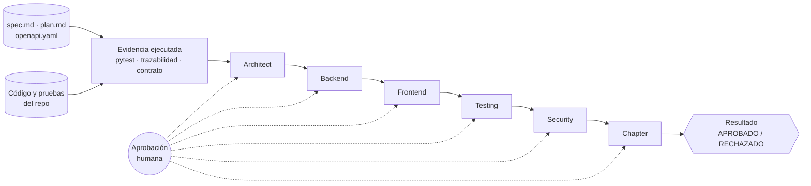

# Crew de validación SDD

Seis agentes de [CrewAI](https://www.crewai.com/) validan un proyecto contra su **especificación** (Spec-Driven Development). Cada agente revisa una parte, cita `archivo:línea` y entrega un informe con hallazgos y veredicto. Una persona aprueba cada informe antes de pasar al siguiente.

Proyecto configurado: [wallet-onboarding-mvp](https://github.com/user-bcp-student10/wallet-onboarding-mvp), con su spec en `specs/001-registro-activacion/`.

## Cómo funciona



1. **Evidencia determinista.** Antes de los agentes, la herramienta ejecuta de verdad las pruebas y las verificaciones del repo, y guarda su salida en `output/evidencia.md`.
2. **Seis validadores**, cada uno con su material y su foco:

| Rol | Recibe | Valida | IDs de la spec |
|---|---|---|---|
| Architect | spec, plan, contrato, tareas, supuestos | Criterios verificables, contradicciones, contrato frente a spec, preguntas sin responsable | CA, RN, RS, RNF |
| Backend | spec, contrato, `app/*.py` | Cada operación, regla y evento contra la spec y el contrato | CA, RN |
| Frontend | spec, contrato, `frontend/*` | Pasos visibles, errores por campo, estados, 390 px, accesibilidad, XSS | CA, RNF |
| Testing | spec, `tests/*.py`, **salida real de pytest** | Trazabilidad CA → prueba, casos negativos y límite, pruebas débiles | CA, RN |
| Security | spec, plan, código, Dockerfile | Cada RS-n, datos personales, hash de clave, ids ajenos, configuración | RS |
| Chapter | spec, evidencia y los 5 informes aprobados | Matriz final, contradicciones, correcciones priorizadas y veredicto | CA |

3. **Aprobación humana** en cada etapa: `s` aprueba, `r` reintenta con tu feedback, `n` detiene el flujo. Lo aprobado queda en un checkpoint ligado al commit del repo validado.
4. **Resultado final.** Un veredicto del modelo **nunca** anula la evidencia:
   - **RECHAZADO** si falla alguna verificación ejecutada, aunque el Chapter apruebe.
   - **NO CONCLUYENTE** sin evidencia, en modo simulado o si el Chapter no emite veredicto.
   - En otro caso, el veredicto del Chapter.

### Formato común de los informes

Cada informe trae Resumen, **Cobertura de la spec** (cada ID con CUMPLE, PARCIAL, NO CUMPLE o NO VERIFICABLE, y su evidencia), **Hallazgos** (`H-BE-1` con severidad, ID de la spec, `archivo:línea`, cita, corrección y cómo verificarla) y Límites de la revisión. Al final va el veredicto. Los agentes no ejecutan nada: tienen prohibido inventar ejecuciones o líneas, y deben marcar como NO VERIFICABLE lo que no puedan comprobar.

## Instalación

Requiere Python 3.11 a 3.13. Clona este repo **al lado** del repo a validar:

```
carpeta-del-curso/
  crew-validacion-sdd/
  wallet-onboarding-mvp/     ← con su .venv y dependencias instaladas
```

```bash
python -m venv .venv
source .venv/bin/activate          # Windows (Git Bash): source .venv/Scripts/activate
pip install -r requirements.txt
cp .env.example .env
```

El repo de la wallet también necesita su entorno, porque la evidencia se ejecuta ahí:

```bash
cd ../wallet-onboarding-mvp && python -m venv .venv && .venv/bin/pip install -r requirements-dev.txt
```

En Windows, el último comando es `.venv/Scripts/pip install -r requirements-dev.txt`.

### Modelo

Se elige en `.env` con `LLM_PROVIDER`:

| Valor | Uso |
|---|---|
| `copilot` (por defecto) | GitHub Copilot, como en los labs. Instala [Copilot CLI](https://github.com/features/copilot/cli), ejecuta `copilot` y luego `/login`. Cada llamada consume uso del plan. |
| `crewai` | Cualquier modelo de CrewAI/LiteLLM. Define `LLM_MODEL` y la API key del proveedor. |
| `simulado` | Sin modelo. Genera informes de ejemplo (sin veredicto) para probar el flujo. |

## Uso

```bash
python validar.py                          # los seis roles, con aprobación humana
python validar.py --solo-evidencia         # solo pruebas y verificaciones, sin modelo
python validar.py --roles backend,testing  # algunos roles
python validar.py --auto                   # aprueba sin preguntar (útil en una demo)
python validar.py --reiniciar              # ignora el checkpoint
python validar.py --repo ../otra-copia     # otra ruta del repo a validar
```

El código de salida es 0 solo si el resultado es APROBADO (o, con `--solo-evidencia`, si toda la evidencia pasa).

### Salida (`output/`)

| Archivo | Contenido |
|---|---|
| `resumen.md` / `resumen.json` | Resultado final, evidencia y veredicto y hallazgos por rol |
| `evidencia.md` / `evidencia.json` | Salida real de cada verificación |
| `<rol>_review.md` | Informe aprobado de cada rol |
| `borradores/` | Último informe generado por cada rol, aprobado o no |
| `.checkpoint.json` | Informes aprobados y commit validado |
| `issues_creadas.json` | Issues creadas con `--crear-issues` |

## Crear issues con los hallazgos

Cierra el ciclo SDD: hallazgo → issue → corrección → nueva validación.

```bash
python validar.py --crear-issues                       # ALTA y MEDIA de los informes aprobados
python validar.py --crear-issues --github-project 2    # ... y agregarlas al Project número 2
python validar.py --crear-issues --severidades ALTA    # solo las ALTA
```

1. Lee **solo los informes que aprobaste** (los del checkpoint en `output/`). No ejecuta agentes.
2. Muestra la lista numerada de hallazgos y te deja elegir: `Enter` (por defecto), `todos`, `ninguno`, `1,3` o `2-4`.
3. Pide una confirmación final antes de crear nada.
4. Crea una issue por hallazgo en el repo del campo `github:` del YAML, o en el remoto `origin` del repo validado.

Cada issue lleva:
- el título `[H-SEC-1] RS-6 · descripción`;
- una tabla con rol, severidad, ID de la spec, `archivo:línea` y commit validado;
- la evidencia, la corrección propuesta, cómo verificarla y un checklist para cerrarla;
- las etiquetas `hallazgo`, `sdd:<rol>` y `severidad:<alta|media|baja>`, que se crean si no existen.

**Sin duplicados:**
- Si vuelves a ejecutar el comando con los mismos informes, no se crea nada nuevo: cada issue guarda una marca oculta con el commit y el ID del hallazgo.
- Si una issue abierta ya cubre el mismo ID de spec y el mismo archivo, el hallazgo aparece como *posible duplicado* y queda fuera de la selección por defecto.

Las issues creadas quedan registradas en `output/issues_creadas.json`.

### Automático

```bash
python validar.py --issues-auto --github-project 2           # tú apruebas cada informe; las issues se crean solas al final
python validar.py --auto --issues-auto --github-project 2    # todo desatendido: informes aprobados sin revisar
```

Con `--issues-auto`, al terminar la validación se crean sin preguntar las issues de los hallazgos ALTA y MEDIA (cámbialo con `--severidades`). Quedan fuera los posibles duplicados. No se crea nada si el flujo se detuvo con `n` o si los informes son simulados.

Con `--auto --issues-auto` nadie revisa los informes antes de crear las issues: úsalo solo si confías en el modelo, porque un hallazgo equivocado se convierte en una issue visible para todo el equipo.

**Requisitos:** [GitHub CLI](https://cli.github.com) con sesión iniciada (`gh auth login`). Para `--github-project` necesitas además el permiso de Projects:

```bash
gh auth refresh -s project
```

Si ese permiso falta, la issue se crea igual y se te avisa para que la agregues al Project a mano. No se necesita MCP.

## Validar otro proyecto

Copia `proyectos/wallet-onboarding.yaml` y ajusta:
- `repo`, `spec`, `plan` y `contrato`;
- `evidencia`: los comandos que demuestran el comportamiento (`python` se reemplaza por el `.venv` del repo);
- `archivos`: qué archivos recibe cada rol (admite patrones `*`).

```bash
python validar.py --proyecto proyectos/mi-proyecto.yaml
```

La spec debe definir sus IDs como encabezados `### CA-n` y como primera columna de tabla (`| RN-n |`, `| RS-n |`, `| RNF-n |`).

## Estructura

```
validar.py                 Punto de entrada (CLI y aprobación humana)
proyectos/*.yaml           Proyectos a validar
sdd_crew/
  roles/                   Los 6 validadores: objetivo, contexto, instrucciones y foco
    base.py                Armado del prompt de cada rol
  formato.py               Formato común de informe y lectura de veredictos y hallazgos
  flujo.py                 Evidencia → roles con aprobación → resultado final
  evidencia.py             Ejecución real de las verificaciones
  proyecto.py              Carga de spec, plan, contrato y archivos con número de línea
  ejecutor.py              Mini-Crew de CrewAI por rol (o informe simulado)
  issues.py                Hallazgos aprobados → issues de GitHub con gh
  llm.py                   Copilot, CrewAI o simulado
tests/                     Pruebas del flujo sin llamar a ningún modelo
```

## Pruebas

```bash
pip install pytest
python -m pytest -v
```

Las pruebas cubren el armado de prompts por rol, la lectura de veredictos y hallazgos, el flujo con aprobación, reintento, rechazo y checkpoint, la regla "la evidencia manda" y la conexión con CrewAI usando un modelo falso. **No llaman a ningún modelo real.**

## Límites

- Los agentes revisan texto: no ejecutan código. Lo que necesita ejecución sale de la evidencia determinista.
- Un informe de un modelo no es una prueba: la persona que aprueba cada etapa es responsable de revisarlo.
- Si el código de un rol supera `limite_caracteres`, los archivos que no entran se omiten y el agente recibe la lista para marcarlos como no revisados.
